# DisasterShield Decision Tree Flowcharts

This document specifies the complete decision-tree logic implemented in **DisasterShield — Disaster Management Guidance Chatbot**.
The logic is fully deterministic, rule-based, and adheres to standard operating procedures issued by the **National Disaster Management Authority (NDMA)**, **Geological Survey of India (GSI)**, **Central Water Commission (CWC)**, and **National Disaster Response Force (NDRF)**.

---

## 1. Earthquake Decision Tree Flowchart

```mermaid
flowchart TD
  classDef startNode fill:#1e3a5f,stroke:#3b82f6,stroke-width:2px,color:#ffffff,font-weight:bold;
  classDef questionNode fill:#f0f9ff,stroke:#0284c7,stroke-width:2px,color:#0f172a;
  classDef criticalGuidance fill:#fef2f2,stroke:#dc2626,stroke-width:2px,color:#991b1b,font-weight:bold;
  classDef urgentGuidance fill:#fffbeb,stroke:#d97706,stroke-width:2px,color:#92400e,font-weight:bold;
  classDef normalGuidance fill:#f0fdf4,stroke:#16a34a,stroke-width:2px,color:#166534,font-weight:bold;

  eq_start["Step 1: Where are you currently located right now?"]
  class eq_start startNode;
  eq_start -->|"Inside a building..."| eq_indoor_status
  eq_start -->|"Outdoors (Street / Open space...)"| eq_outdoor_status
  eq_start -->|"Inside a moving or stopped motor..."| eq_vehicle_status

  eq_indoor_status["Step 2: What is the immediate situation inside the building?"]
  class eq_indoor_status questionNode;
  eq_indoor_status -->|"The ground / building is actively..."| eq_indoor_active_shaking
  eq_indoor_status -->|"Shaking has stopped; inspecting s..."| eq_indoor_hazard_check
  eq_indoor_status -->|"Trapped under debris, rubble, or..."| eq_indoor_trapped_protocol

  eq_indoor_active_shaking["Step 3: What type of cover or room features are immediately accessible?"]
  class eq_indoor_active_shaking questionNode;
  eq_indoor_active_shaking -->|"A sturdy wooden/metal table or he..."| eq_guidance_drop_cover_hold
  eq_indoor_active_shaking -->|"No sturdy furniture nearby; only..."| eq_guidance_interior_wall_shield

  eq_indoor_hazard_check["Step 3: Shaking stopped. Are you detecting any utility hazards?"]
  class eq_indoor_hazard_check questionNode;
  eq_indoor_hazard_check -->|"Smell of gas leak, electrical sp..."| eq_guidance_utility_emergency
  eq_indoor_hazard_check -->|"No gas smell or fire, but stairs..."| eq_indoor_evacuation_choice

  eq_indoor_evacuation_choice["Step 4: What floor are you on, and exit pathway state?"]
  class eq_indoor_evacuation_choice questionNode;
  eq_indoor_evacuation_choice -->|"Ground floor / 1st floor with cl..."| eq_guidance_evacuate_ground
  eq_indoor_evacuation_choice -->|"Multi-story / high-rise building..."| eq_guidance_highrise_evac

  eq_indoor_trapped_protocol["Step 4: Assess physical mobility & respiratory environment:"]
  class eq_indoor_trapped_protocol questionNode;
  eq_indoor_trapped_protocol -->|"Airway open, can tap objects or..."| eq_guidance_trapped_signaling
  eq_indoor_trapped_protocol -->|"Dense dust, smoke, or constricte..."| eq_guidance_trapped_dust_management

  eq_outdoor_status["Step 2: What are your immediate physical surroundings outdoors?"]
  class eq_outdoor_status questionNode;
  eq_outdoor_status -->|"High-density street with tall bu..."| eq_outdoor_urban_hazards
  eq_outdoor_status -->|"Open field, wide park, sports gr..."| eq_guidance_open_field_stay
  eq_outdoor_status -->|"Near steep hillsides, cliffs, ro..."| eq_guidance_slope_coastal_outdoor

  eq_outdoor_urban_hazards["Step 3: Are live power cables down or is masonry falling?"]
  class eq_outdoor_urban_hazards questionNode;
  eq_outdoor_urban_hazards -->|"Downed electrical cables or tran..."| eq_guidance_downed_powerlines
  eq_outdoor_urban_hazards -->|"Falling glass/parapets; need im..."| eq_guidance_urban_debris_cover

  eq_vehicle_status["Step 2: Where is the vehicle currently positioned?"]
  class eq_vehicle_status questionNode;
  eq_vehicle_status -->|"On an overpass, flyover, bridge..."| eq_guidance_bridge_vehicle
  eq_vehicle_status -->|"Open highway or street, clear of..."| eq_guidance_open_road_vehicle

  eq_guidance_drop_cover_hold["IMMEDIATE LIFE-SAFETY: DROP, COVER, AND HOLD ON"]
  class eq_guidance_drop_cover_hold criticalGuidance;

  eq_guidance_interior_wall_shield["IMMEDIATE LIFE-SAFETY: INTERIOR WALL SHIELDING"]
  class eq_guidance_interior_wall_shield criticalGuidance;

  eq_guidance_utility_emergency["UTILITY HAZARD & FIRE SUPPRESSION PROTOCOL"]
  class eq_guidance_utility_emergency criticalGuidance;

  eq_guidance_evacuate_ground["ORDERLY EVACUATION TO OPEN ASSEMBLY ZONE"]
  class eq_guidance_evacuate_ground urgentGuidance;

  eq_guidance_highrise_evac["MULTI-STORY EVACUATION & AFTERSHOCK PROTOCOL"]
  class eq_guidance_highrise_evac urgentGuidance;

  eq_guidance_trapped_signaling["SEARCH & RESCUE SIGNALING PROTOCOL"]
  class eq_guidance_trapped_signaling criticalGuidance;

  eq_guidance_trapped_dust_management["CONFINED AIRWAY & COLLAPSE DEFENSE PROTOCOL"]
  class eq_guidance_trapped_dust_management criticalGuidance;

  eq_guidance_downed_powerlines["DOWNED HIGH-VOLTAGE CABLE PROTOCOL"]
  class eq_guidance_downed_powerlines criticalGuidance;

  eq_guidance_urban_debris_cover["URBAN FALLING DEBRIS DEFENSE"]
  class eq_guidance_urban_debris_cover urgentGuidance;

  eq_guidance_open_field_stay["SAFE OPEN-GROUND PERIMETER SECURED"]
  class eq_guidance_open_field_stay normalGuidance;

  eq_guidance_slope_coastal_outdoor["SECONDARY HAZARD: ROCKFALL & TSUNAMI EVACUATION"]
  class eq_guidance_slope_coastal_outdoor criticalGuidance;

  eq_guidance_bridge_vehicle["VEHICLE ON ELEVATED / TUNNEL INFRASTRUCTURE"]
  class eq_guidance_bridge_vehicle criticalGuidance;

  eq_guidance_open_road_vehicle["VEHICLE SAFE-STOP PROTOCOL"]
  class eq_guidance_open_road_vehicle urgentGuidance;
```

---

## 2. Flood & Flash Flood Decision Tree Flowchart

```mermaid
flowchart TD
  classDef startNode fill:#1e3a5f,stroke:#3b82f6,stroke-width:2px,color:#ffffff,font-weight:bold;
  classDef questionNode fill:#f0f9ff,stroke:#0284c7,stroke-width:2px,color:#0f172a;
  classDef criticalGuidance fill:#fef2f2,stroke:#dc2626,stroke-width:2px,color:#991b1b,font-weight:bold;
  classDef urgentGuidance fill:#fffbeb,stroke:#d97706,stroke-width:2px,color:#92400e,font-weight:bold;

  flood_start["Step 1: What is your current location and setting regarding flood?"]
  class flood_start startNode;
  flood_start -->|"Inside a house, apartment..."| flood_indoor_severity
  flood_start -->|"Outdoors on foot (Road, alley...)"| flood_outdoor_severity
  flood_start -->|"Inside a motor vehicle..."| flood_vehicle_severity

  flood_indoor_severity["Step 2: How high has water risen inside/around building?"]
  class flood_indoor_severity questionNode;
  flood_indoor_severity -->|"Water starting to seep (< 6 in)..."| flood_indoor_utility_check
  flood_indoor_severity -->|"Water rising rapidly (Flash surge)..."| flood_guidance_vertical_evac
  flood_indoor_severity -->|"Ground floor submerged; on roof..."| flood_indoor_rooftop_signaling

  flood_indoor_utility_check["Step 3: Where is electrical breaker relative to water?"]
  class flood_indoor_utility_check questionNode;
  flood_indoor_utility_check -->|"Main breaker dry & accessible..."| flood_guidance_isolate_utilities_evac
  flood_indoor_utility_check -->|"Water reached panel / submerged..."| flood_guidance_submerged_electrical_hazard

  flood_indoor_rooftop_signaling["Step 4: Are you on open rooftop or inside enclosed attic?"]
  class flood_indoor_rooftop_signaling questionNode;
  flood_indoor_rooftop_signaling -->|"On open rooftop / balcony..."| flood_guidance_rooftop_rescue_ready
  flood_indoor_rooftop_signaling -->|"Trapped in enclosed attic..."| flood_guidance_attic_escape_protocol

  flood_outdoor_severity["Step 2: What are characteristics of outdoor water?"]
  class flood_outdoor_severity questionNode;
  flood_outdoor_severity -->|"Water actively flowing / current..."| flood_guidance_never_cross_moving_water
  flood_outdoor_severity -->|"Stagnant standing water..."| flood_outdoor_hazards_check

  flood_outdoor_hazards_check["Step 3: Submerged drains, downed poles, or reptiles?"]
  class flood_outdoor_hazards_check questionNode;
  flood_outdoor_hazards_check -->|"Downed electrical cables / drains..."| flood_guidance_downed_wire_drain_hazard
  flood_outdoor_hazards_check -->|"No live wires; high ground visible..."| flood_guidance_seek_immediate_high_ground

  flood_vehicle_severity["Step 2: What is vehicle's exact situation on road?"]
  class flood_vehicle_severity questionNode;
  flood_vehicle_severity -->|"Driving towards submerged road..."| flood_guidance_turn_around_dont_drown
  flood_vehicle_severity -->|"Vehicle stalled in rising water..."| flood_vehicle_escape_check
  flood_vehicle_severity -->|"Vehicle floating / being swept..."| flood_guidance_vehicle_floating_escape

  flood_vehicle_escape_check["Step 3: Can you open doors or jammed by water pressure?"]
  class flood_vehicle_escape_check questionNode;
  flood_vehicle_escape_check -->|"Doors can open; water below sill..."| flood_guidance_abandon_vehicle_immediately
  flood_vehicle_escape_check -->|"Doors jammed by outside pressure..."| flood_guidance_vehicle_window_escape

  flood_guidance_isolate_utilities_evac["UTILITY ISOLATION & VERTICAL RELOCATION"]
  class flood_guidance_isolate_utilities_evac urgentGuidance;

  flood_guidance_submerged_electrical_hazard["EXTREME ELECTROCUTION DANGER — EVACUATE"]
  class flood_guidance_submerged_electrical_hazard criticalGuidance;

  flood_guidance_vertical_evac["EMERGENCY VERTICAL EVACUATION (RAPID RISE)"]
  class flood_guidance_vertical_evac criticalGuidance;

  flood_guidance_rooftop_rescue_ready["ROOFTOP SEARCH & RESCUE PREPARATION"]
  class flood_guidance_rooftop_rescue_ready urgentGuidance;

  flood_guidance_attic_escape_protocol["CRITICAL ATTIC BREACH PROTOCOL"]
  class flood_guidance_attic_escape_protocol criticalGuidance;

  flood_guidance_never_cross_moving_water["IMMEDIATE RULE: NEVER CROSS MOVING FLOODWATERS"]
  class flood_guidance_never_cross_moving_water criticalGuidance;

  flood_guidance_downed_wire_drain_hazard["HIGH-VOLTAGE & MANHOLE SUCTION DANGER"]
  class flood_guidance_downed_wire_drain_hazard criticalGuidance;

  flood_guidance_seek_immediate_high_ground["HIGH-GROUND RELOCATION PROTOCOL"]
  class flood_guidance_seek_immediate_high_ground urgentGuidance;

  flood_guidance_turn_around_dont_drown["MOTORIST SAFETY: TURN AROUND, DON'T DROWN"]
  class flood_guidance_turn_around_dont_drown urgentGuidance;

  flood_guidance_abandon_vehicle_immediately["IMMEDIATELY ABANDON STALLED VEHICLE"]
  class flood_guidance_abandon_vehicle_immediately criticalGuidance;

  flood_guidance_vehicle_window_escape["SUBMERGED VEHICLE WINDOW ESCAPE PROTOCOL"]
  class flood_guidance_vehicle_window_escape criticalGuidance;

  flood_guidance_vehicle_floating_escape["FLOATING VEHICLE EMERGENCY ESCAPE"]
  class flood_guidance_vehicle_floating_escape criticalGuidance;
```

---

## 3. Landslide & Debris Flow Decision Tree Flowchart

```mermaid
flowchart TD
  classDef startNode fill:#1e3a5f,stroke:#3b82f6,stroke-width:2px,color:#ffffff,font-weight:bold;
  classDef questionNode fill:#f0f9ff,stroke:#0284c7,stroke-width:2px,color:#0f172a;
  classDef criticalGuidance fill:#fef2f2,stroke:#dc2626,stroke-width:2px,color:#991b1b,font-weight:bold;
  classDef urgentGuidance fill:#fffbeb,stroke:#d97706,stroke-width:2px,color:#92400e,font-weight:bold;
  classDef normalGuidance fill:#f0fdf4,stroke:#16a34a,stroke-width:2px,color:#166534,font-weight:bold;

  ls_start["Step 1: Current phase of landslide event?"]
  class ls_start startNode;
  ls_start -->|"Early warning signs (cracks/rumbling)..."| ls_early_warning_location
  ls_start -->|"Active landslide or debris flow now..."| ls_active_slide_location
  ls_start -->|"Slide stopped; assessing damage/trapped..."| ls_aftermath_assessment

  ls_early_warning_location["Step 2: Where are you observing warning signs?"]
  class ls_early_warning_location questionNode;
  ls_early_warning_location -->|"At home/building on hill slope..."| ls_early_warning_signs_building
  ls_early_warning_location -->|"Traveling along mountain road/ghat..."| ls_early_warning_mountain_road

  ls_early_warning_signs_building["Step 3: Which specific signs are visible around building?"]
  class ls_early_warning_signs_building questionNode;
  ls_early_warning_signs_building -->|"Widening cracks, muddy springs, tilted poles..."| ls_guidance_preemptive_evac_hillside
  ls_early_warning_signs_building -->|"Minor plaster cracks during monsoon..."| ls_guidance_hillside_monitoring_prep

  ls_early_warning_mountain_road["Step 3: Road conditions on mountain pass?"]
  class ls_early_warning_mountain_road questionNode;
  ls_early_warning_mountain_road -->|"Trickling gravel/pebbles falling..."| ls_guidance_mountain_road_retreat
  ls_early_warning_mountain_road -->|"Culverts overflowing with mud/branches..."| ls_guidance_blocked_culvert_corridor

  ls_active_slide_location["Step 2: Where situated during active movement?"]
  class ls_active_slide_location questionNode;
  ls_active_slide_location -->|"Outdoors in path of debris..."| ls_active_outdoor_escape_feasibility
  ls_active_slide_location -->|"Trapped inside building being hit..."| ls_guidance_indoor_impact_shelter
  ls_active_slide_location -->|"Inside vehicle on hill road..."| ls_guidance_vehicle_active_slide

  ls_active_outdoor_escape_feasibility["Step 3: Can you sprint sideways (laterally)?"]
  class ls_active_outdoor_escape_feasibility questionNode;
  ls_active_outdoor_escape_feasibility -->|"Yes, clear lateral path to ridge..."| ls_guidance_lateral_escape_sprint
  ls_active_outdoor_escape_feasibility -->|"No escape; debris closing in..."| ls_guidance_curl_protect_head

  ls_aftermath_assessment["Step 2: Primary condition of post-slide area?"]
  class ls_aftermath_assessment questionNode;
  ls_aftermath_assessment -->|"River or stream dammed by debris..."| ls_guidance_landslide_dam_burst_alert
  ls_aftermath_assessment -->|"Persons or homes buried; secondary slides..."| ls_guidance_post_slide_rescue_caution

  ls_guidance_preemptive_evac_hillside["IMMEDIATE HILLSIDE PREEMPTIVE EVACUATION"]
  class ls_guidance_preemptive_evac_hillside criticalGuidance;

  ls_guidance_hillside_monitoring_prep["HEIGHTENED HILLSIDE MONITORING & READINESS"]
  class ls_guidance_hillside_monitoring_prep normalGuidance;

  ls_guidance_mountain_road_retreat["MOUNTAIN ROADWAY PRE-COLLAPSE RETREAT"]
  class ls_guidance_mountain_road_retreat urgentGuidance;

  ls_guidance_blocked_culvert_corridor["DEBRIS DAM BURST WARNING ON MOUNTAIN PASS"]
  class ls_guidance_blocked_culvert_corridor criticalGuidance;

  ls_guidance_lateral_escape_sprint["LIFE-OR-DEATH: LATERAL SPRINT AWAY FROM PATH"]
  class ls_guidance_lateral_escape_sprint criticalGuidance;

  ls_guidance_curl_protect_head["LAST-RESORT IMPACT STANCE: TIGHT CURL & HEAD SHIELD"]
  class ls_guidance_curl_protect_head criticalGuidance;

  ls_guidance_indoor_impact_shelter["INDOOR DEBRIS IMPACT SHELTER PROTOCOL"]
  class ls_guidance_indoor_impact_shelter criticalGuidance;

  ls_guidance_vehicle_active_slide["VEHICLE ACTIVE ROCKFALL & SLIDE MITIGATION"]
  class ls_guidance_vehicle_active_slide criticalGuidance;

  ls_guidance_landslide_dam_burst_alert["CRITICAL FLASH FLOOD ALERT: LANDSLIDE DAM"]
  class ls_guidance_landslide_dam_burst_alert criticalGuidance;

  ls_guidance_post_slide_rescue_caution["POST-LANDSLIDE CAUTIOUS RESCUE & DAMAGE ASSESSMENT"]
  class ls_guidance_post_slide_rescue_caution urgentGuidance;
```

